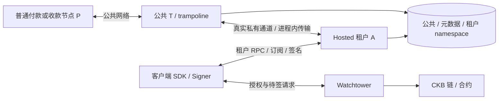

# Fiber PR #1623：测试工程整理、验证策略与新会话交接

复核日期：2026-11-08（Asia/Shanghai）。用途：先整理多轮、多模型迭代形成的测试工程，建立一致的运行与证据基础，再补 Hosted LSP 业务场景。本文是工程与测试策略，不是新增用例表、审批记录或覆盖率台账。后续任务以用户选定的阶段为范围，不把整份路线图一次性执行。

交付说明：本文随测试工程整理 PR 进入 Git。文中 `report/`、`reports/`、`tmp/`、`download/`、`source/ckb-cli` 和绝对路径属于本机证据或外部运行输入，不在本仓库提交范围内，克隆仓库后不保证存在；受版本控制的模板、链快照和合约以文件本身为准。

用户最新决定：**先做整个测试项目的梳理，保持工程逻辑一致、结构清晰；完成工程优化基础后，再推进业务补测。** 本文据此替换上一版“直接从 PAYMENT-05 开始”的派任务建议。整体梳理覆盖仓库目录、共用框架和执行链；实际修改先集中在 PR #1623 的测试及其依赖，不顺带重写无关模块。

新会话优先读第1～2节的范围/基线、第4.2～4.3节的工程问题、第5节首阶段及第8节首任务。第3节资料按具体疑点查阅，后续业务路线不在工程阶段执行。

## 1. 接手时先知道这五件事

1. **不要以“补到 44/44”为目标。** `38/44` 是产品 `56c761c` 的历史行为清单，混合 Rust 测试、Python E2E 和单分支退款。勾选不能替代当前版本的输入、断言与原始执行证据。
2. **已合并的是测试 PR #14，产品 PR #1623 仍开放。** 当前产品已更新；旧版本的通过不能转记为新版本通过。
3. **默认根工作树不是最新整合测试。** 根目录有大量用户未提交内容；实际核查的新测试在 `tmp/lsp-p0-1`。不要清理、覆盖或把两份测试拼起来运行。
4. **先整理工程，再补行为。** 首阶段统一职责、入口、产物校验、生命周期、证据与文档，保持既有测试语义；PAYMENT-05 和其他补测在工程验收后另派任务。
5. **历史探索不是待执行任务。** 旧 README 中“待跑”“下一步”“1+3”等文字不构成新授权；本次不重启已收尾的旧批，也不默认启动退款、自然竞态或全量回归。

## 2. 版本和工作区：不要混用

| 对象 | 本次已核实的值 | 接手方式 |
| --- | --- | --- |
| 产品 PR | [nervosnetwork/fiber#1623](https://github.com/nervosnetwork/fiber/pull/1623)，OPEN | 首次接手查询一次远端；批内固定 SHA，不自动追新 head |
| 新产品候选 | `76307312e8de518c9a32074e6d16867c04de4f86` | 本次只读 diff，没有构建或运行这个版本 |
| 完整 PR 审阅基准 | PR 元数据的 base 与本次 merge-base 均为 `45ffdac8bd2d56f6e9cd4a01c2b2e4975c3e4397` | 完整影响面使用这个基准到候选的差异；不只看56c之后的增量 |
| 历史产品基线 | `56c761c45c271c086b05c8d5ea3e033448f5fdf8` | 38/44、D5、Delivery-07、自然退款结果对应它 |
| 更旧产品 | `84333eea8488a8afc7e4474aa4bbd0e7e973cee9`；`04c206465b48da85b99aa58e80afe9801a2cb2db` | 只作历史依据，不混算当前结果 |
| 测试仓库远端 | `sunchengzhu/fiber-py-integration-test` 的 `codex/lsp-core-regressions` | 本次远端 tip 为 `4052079f374376eb31b951788ecc4e8f4e9c9c35` |
| 测试 PR | [#14](https://github.com/sunchengzhu/fiber-py-integration-test/pull/14)，2026-11-08 02:29:39 合并 | merge SHA 即上一行；它合入 F2 SDK 快测及入口自检 |
| 本次核查测试树 | `/Users/sunchengzhu/project/fiber-py-integration-test/tmp/lsp-p0-1`，detached HEAD `9b57feb3d8a31cb0cb342d047e2c310ca1c2276e` | GitHub compare 确认与 #14 merge 提交文件差异为空；存在未跟踪证据和工具，不删除 |
| 默认根工作树 | `/Users/sunchengzhu/project/fiber-py-integration-test`，`codex/lsp-core-regressions@cf937275` | 有大量未提交修改；只保留和读取，不直接 reset/pull 覆盖 |
| 已有旧产品源码 | `/Users/sunchengzhu/project/fiber-py-integration-test/download/fiber/source-pr-1623-56c761c4` | HEAD 已核实为完整 `56c761c…`；适合解释旧结果 |
| 另一产品工作树 | `/Users/sunchengzhu/project/fiber`，本次为 `develop@4777d5d6` | 不是 LSP 被测候选，不因路径熟悉就拿来跑 |

建议在实际实施时从已合并测试分支建立独立、干净的 `codex/` 工作分支/工作树，并在独立产品 checkout 固定候选。先检查现有对象和缓存，必要时才获取目标提交；不为了读背景资料克隆、切换或更新其他仓库。开始时记录两个仓库的 SHA、Git 状态、Python 环境、FNN/SDK/driver bundle、CKB 与合约来源及摘要。

本地路径只对这台机器有效。新会话不能读取旧证据时，记录“原始证据不可用”，保留 Git 中的摘要作为历史记录；不要把摘要伪装成亲自复验。产品合约版本必须从实际 bundle/模板/部署字节确定，不能由 FNN SHA 猜出 fiber-scripts 版本。

### 2.1 完整 PR 与最近增量是两个范围

本次通过分页 PR files API 核实完整 PR 为 **378 个文件**：其中 `crates/fiber-lib` 93、SDK 15、store 5、types 13、JSON types 9、上游 `tests/` 223，另含 binary/CLI/WASM、配置、构建和文档。这个数字只说明变更范围，不是用例分母；本次没有逐行审完六万余新增行。

完整 PR 影响面至少含：租户身份/namespace、actor与本地传输、签名SDK/策略/持久化、RPC和订阅、Delivery与付款、Watchtower、迁移/schema、feature/native/WASM兼容及测试设施。`56c→763` 的18个提交仅是最近回归增量，不能代表全部风险。

远端 `develop` 是移动分支。本次按其名字查询时 compare 的 base 已返回另一提交；不能拿分支名替换记录中的固定基准。GitHub compare 的 files 输出还可能截断到300项；完整文件清单应分页取得，并核对总数，不能凭截断结果声称全PR已覆盖。工程阶段不要求重跑全部上游测试，只要求不遗漏这些责任边界。

### 2.2 产品模型、信任边界与支持范围

PR描述直接引用 [移动端问题 #1571](https://github.com/nervosnetwork/fiber/issues/1571) 和 [Hosted LSP设计 #1625](https://github.com/nervosnetwork/fiber/issues/1625)。核心是一个公共T进程托管多个租户数据平面，使用真实私有通道和现有Fiber协议；离线收款先保留上游TLC，待租户恢复后推进，不是给租户数据库记一笔托管余额。[当前设计][hosted]



图中是逻辑关系：外部请求经过共享RPC网关，不能由图推导为租户拥有独立公网端口。RootSigner、channel keys和nonce在客户端；tenant协议身份/发票签名仍在LSP，funding wallet又是独立职责。合法tenant Biscuit是后续MVP RPC凭据，不能擅自要求每次RPC增加RootSigner二次证明。[身份边界][remote]

必须区分**原型功能可用**与**生产非托管安全完整**。固定设计仍列出生产session/readiness、严格nonce及策略方面的缺口；但文档的具体“未实现”列表也有滞后，必须追源码。移走通道密钥不等于消除对主机身份、发票、可用性和拒绝服务的信任。[安全边界][remote]

| 维度 | 本PR边界 | 测试推论 |
| --- | --- | --- |
| 多通道、多资产 | 同租户支持多条CKB/UDT通道；同资产选择，首次dispatch前可重选 | CKB单通道通过不能代表UDT/多通道；已有Rust覆盖先查，按实际缺层补代表场景 |
| MPP | 支持一个上游TLC向下游拆分；不支持上游多TLC聚合 | 不能把upstream MPP成功当待补正常用例；验证拒绝边界不应破坏原执行 |
| 离线与就绪 | runtime在线、通道ready、signer连接、状态同步、授权就绪不同 | 当前channel-online行为不能冒充生产TenantSignReady，也不能先规定signer离线永远Deferred |
| 签名策略 | 测试Agent的Manual/显式确认与SDK默认Auto不同 | Auto并非没有实现；Manual E2E不能证明Auto策略，先读policy/session单测和所用模式 |
| 密钥及preimage | invoice授权、TLC fulfillment授权、秘密释放授权是不同步骤 | 无可执行恢复证据时不得把成功签名当安全释放证明；查实际持久化和链验证入口 |
| 非目标 | 生产push/mailbox、多设备fencing、跨LSP迁移/HA、所有链上路径离线预签均不能由当前原型推导 | 保留范围限制，不把所有远景都自动转成此PR必写用例 |

支持矩阵以[Hosted行为][hosted]、[remote signer设计][remote]及[SDK策略实现][policy]为入口，不以清单勾选数替代。

## 3. 资料怎么读，读到哪里停

下文 `TEST_ROOT` 指上一节的 `tmp/lsp-p0-1` 或接手后从同一已合并版本建立的新测试树；`OLD_PRODUCT` 指上一节固定 56c 的产品源码。这些是文档缩写，不是要求设置的环境变量。

先读：

1. 用户提供的 AGENTS 指令，以及所选工作树最近的 `AGENTS.md`；保留用户本次要求，不能因旧工作树规则较宽而覆盖它。
2. [ai-test-agent skill](/Users/sunchengzhu/project/ai-test-agent/SKILL.md)。维护已有测试按 `references/automation-maintenance.md`；新行为按 `references/review-cases.md`；核覆盖按 `references/verification-quality.md`。
3. `TEST_ROOT/reviews/review-feedback.md`，只抽取当前行为相关的纠正约束。
4. 下表中本批对应的评审、全部 TEST-MAP、实际代码和必要源码 diff。不要一次通读全部历史报告。

| 本批主题 | 评审入口，相对 TEST_ROOT | 测试/辅助入口，相对 TEST_ROOT |
| --- | --- | --- |
| 出站付款 D5 | `reviews/lsp/delayed-payment-recovery.md` 的 PAYMENT-05 | `test_cases/fiber/devnet/lsp/test_hosted_outbound_payment.py`；其基类在 `test_hosted_invoice_cancellation.py` |
| 新 head 的 RPC 租户分派 | `reviews/lsp/hosted-tenant-boundaries.md`、`hosted-invoice-cancellation.md` | `test_tenant_boundaries.py`、`test_hosted_invoice_cancellation.py`；以下裸测试文件均在 `test_cases/fiber/devnet/lsp/` |
| Delivery 接纳与结果一致性 | `reviews/lsp/delivery-acceptance-consistency.md` | `test_delivery_acceptance.py`、`_delivery_node.rs`、`scripts/build_lsp_delivery_node.py` |
| 完整 FNN 重启 | `reviews/lsp/delivery-fnn-restart.md` | `test_delivery_fnn_restart.py`；普通 SDK/FNN 恢复另见 `test_channel_signing_recovery.py` |
| SDK 缺授权 | `reviews/lsp/delayed-payment-recovery.md`、`field-feedback-scope.md` | `test_payment_authorization_recovery.py` |
| Watchtower | `reviews/lsp/watchtower-settlement.md` 及 scope | `test_watchtower_settlement.py`、`_watchtower_chain.rs`、`_watchtower_rpc.py` |
| 期限与强关 | `reviews/lsp/channel-signing-deadline.md` 及 scope | `test_channel_signing_deadline.py` |
| 长时退款及 F2 | `reviews/lsp/tlc-timeout-refund.md`、`tlc-refund-f2-fast-plan.md` | `test_cases/fiber/devnet/lsp_nightly/README.md`、`test_tlc_timeout_refund.py`、`_refund_ledger.py`、`test_tlc_refund_adapter_fast.py`；入口自检为 `test_cases/framework/test_lsp_refund_f2_runner.py` |

两个查找入口仅作索引：`reviews/lsp/pr-1623-key-behaviors.md`、`test_cases/fiber/devnet/lsp/README.md`。两者包含不同日期的追加记录和过期“下一步”，不可直接复制为当前待办。

### 3.1 官方介绍与业内实现：借鉴问题，不移植契约

来源优先级是：本批明确的用户/产品约定 → 固定版本规范与实现的对照 → 已确认评审/测试证据 → 历史介绍与同行实现。发现冲突时保留两边及版本，不能任选一边改成容易通过的预期。

| 一手资料 | 对本工程有用的视角 | 不能据此要求Fiber实现什么 |
| --- | --- | --- |
| [Fiber light paper][paper]、[8月开发日志][dev-aug] | 多资产、链上保护及移动端Hosted方向，帮助检查整体责任边界 | 介绍中的“自动退款”不是无需签名/广播/成熟的RPC保证；远景不等于本PR交付范围 |
| [10月1日开发日志][dev-oct1]、[10月29日开发日志][dev-oct29] | 客户端需验证请求；WS重连需重新订阅；磁盘同步配置影响持久性语义 | 不能把历史polling方案当当前唯一入口，也不能把进程重启等同断电安全 |
| [VLS validating signer][vls] | 不只是保管密钥，还要验证状态和策略；拒签测试必须触达目标验证层 | 不直接套Bitcoin交易/HTLC规则、VLS策略或密码学假设到CKB/TLC |
| [Greenlight signer state][greenlight] | 不可信节点提供状态时需考虑回滚、历史锚定与多设备视角 | Greenlight的无状态signer方案不是Fiber现有SignerStore契约；只提供候选威胁问题 |
| [LDK Persist][ldk-persist] | 持久化确认与协议推进必须有明确关系；失败与完成通知需要可检验 | 不要求Fiber照搬ChannelMonitor API；映射为SDK保存→返回签名、FNN receipt→continuation等真实边界 |
| [LDK异步付款设计][ldk-async]、[LSPS2/bLIP52][lsps2] | 区分远程签名、离线协调与即时流动性，关注谁的资金被占用、何时释放 | 本PR不是LSPS2 JIT开户，也不是LDK静态发票协议；不引入不属于Fiber的成功条件 |

以上资料均于本次复核查询。外部资料产生的风险问题只能作为候选，先与Fiber源码和已有测试去重，再进入具体评审，不直接新增ID。尤其 #1625 的实现状态注明2026-09-09，部分仍写polling；当前固定设计已是WS subscription，应保留时间差异。

重要历史证据仍在 `TEST_ROOT/report/lsp-p0-1/`：

- `AUDIT.md`：56c 迁移、SDK 重启环境变量、取消签名流程、wrapper 兼容和失败归因；前面的阶段记录可能被后文更新。
- `d5fix9.xml`：D5 为 `1 passed / 95.22s`，只证明代码实际断言的终态。
- `delivery-07b.xml`：重启记录/replay 检查为 `1 passed / 118.69s`。
- `delivery-02-run4.xml`：`original K failed but downstream paid`，早期断言失败。
- `refund-natural5-full.log`、`refund-natural5-full/artifacts/progress.jsonl`：56c 主退款 `1 passed in 15140.19s`，分支 `T-then-A-sweep`。

F2 实施复核另见 `TEST_ROOT/docs/analysis/f2-fast-implementation-review-2026-11-08.md`。旧 843 独立 TLC 两轮证据在 `/Users/sunchengzhu/.codex/worktrees/lsp-reviewed-regressions/fiber-py-integration-test/report/lsp-refund-84333ee-20261030T1300/RESULT.md`。`report/`、`reports/` 和下载产物不是 Git 中可保证存在的文件，读取前检查存在性，勿提交节点密钥或整个数据目录。

## 4. 如何判断一项已经测到了

角色约定：A 为 Hosted 租户，T 为公共 LSP/trampoline，P 为普通付款或收款节点；SDK/Agent 持有 A 的签名与授权；S 为链上手续费出资方，D_A 为 A 的独立收款地址。入站是 P→T→A，出站是 A→T→P，两者不能共用方向相反的资金公式。

整体按一条业务生命周期展开：租户身份/权限 → 外部注资与通道就绪 → 入站、出站、取消 → 签名/订阅/Delivery 的重试和恢复 → 期限保护、关闭与链上取回。每个本批行为先有有效正常对照，再选择最有风险的无效输入、重复请求、并发或崩溃边界，最后检查终态和副作用；不对全部参数做无差别笛卡尔积。

横向守住四个不变量：租户不能串数据/串授权；同一执行不能重复支出；不知道结果时不能当失败重建另一份执行；终态必须与余额、费用、TLC及链上支出一致。payment hash 不是所有操作的幂等key，Delivery应关联真实incoming channel/TLC；同hash的新incoming执行与原key重放分开判断。全局余额总和不能掩盖某个原key上游失败、下游已付款。

顺序是：**已确认行为/产品规范 → 当前固定版本 diff → 用例输入与全部映射断言 → 同版本原始结果**。源码解释当前实现，不自动成为期望；README 和探索日志帮助找证据，不反向定义产品契约。

每批都说明四件事：

- **入口**：真实 RPC、原 SDK/Agent、测试 wrapper 或直接调用内部函数；明确是哪一层。
- **检查点**：已经实际进入目标状态，有唯一 payment hash、channel、incoming TLC/key 或 signing request 证据；未取得检查点不能算业务通过。
- **结果依据**：独立计算的余额/费用/资金守恒、既定状态规则、真实交易及授权关联；不要把同一产品函数输出当独立预期。
- **观察终点**：最终状态、无重复执行、活动 TLC/锁定额/待签清理、资金去向，以及有理由的稳定窗口。仅 RPC 返回成功或出现一条日志不足以覆盖完整业务。

测试优先保持 Python 线性功能用例，复用框架真实签名和有界 wait；Rust 单测用于解释已有覆盖和精确内部边界，不擅自把本批变成新的 Rust 压力测试项目。并行代理可读源码/评审；共用固定端口、数据目录或 Cargo 缓存的执行不能无锁并发。

### 4.1 用完整责任地图控制遗漏

这是分析导航，不是新增用例清单或通过状态表。每次只展开选定的一组行为，其余保留为未核实范围。

| 责任边界 | 关键不变量 | 最合适的证据组合 |
| --- | --- | --- |
| 身份、RPC、namespace、eviction | token/host/tenant/channel绑定正确，冷查询不意外激活，忙租户不能被错误驱逐 | registry/scope Rust测试 + 真实双租户RPC正负对照 |
| 开通、签名与订阅 | 签的是批准的条款；旧/重复/冲突请求区分；断线不丢当前工作 | SDK确定性验证 + RPC真实receipt/订阅 + 通道生命周期 |
| 付款、取消、Delivery | 同一incoming执行不重复扣款，失败不会污染别的执行，最终上下游一致 | 状态机单测 + P/T/A真实付款与逐段资金观察 |
| 策略与秘密释放 | Manual/Auto结果符合各自规则；保存失败不能泄漏签名/preimage | policy/store故障单测 + 原Agent实际释放入口；不只看Python主动控制成功 |
| 恢复和持久化 | 接纳→dispatch、签名保存→提交、receipt→continuation等边界可解释 | 已有Rust checkpoint测试 + 必要完整进程恢复；优雅停止、SIGKILL、磁盘/断电分别命名 |
| 链上保护 | 成熟、输入、签名、目的地和费用都正确；旧承诺与TLC有合法收尾 | SDK负向有效对照 + 固定合约真实链 + 独立账本 |
| 资源与公平性 | 一个租户离线/拒签/达限不拖垮其他租户；配额拒绝无副作用 | 有界双租户功能测试；吞吐、长压和商业SLA另行定义 |
| 资产、版本、迁移、平台 | 资产不串用；旧记录按真实版本迁移；feature关闭和共享API不回归 | 复用migration/schema/native/WASM/feature测试；Python E2E不能替代，WASM不代表托管公网LSP支持 |

不要把“76个lsp::tests通过”当作SDK、Agent、store迁移和所有channel测试都已执行。相关源码已存在 receipt后continuation恢复测试；真正要补的边界应从具体测试未触达之处确定，而不是从旧设计文字推断全部未测。[已有恢复测试][restart-tests]

### 4.2 已证实的工程问题与有限优化目标

下列问题来自测试基线的源码核查，不表示整个项目需要重写。首阶段处理职责和入口一致性，不改变业务期待来消灭失败。

| 已证实的问题 | 证据入口，相对TEST_ROOT | 整理目标 |
| --- | --- | --- |
| 跨test文件继承泄漏生命周期 | D5→`_CancellationBase`→`_DelayedPaymentBase`；取消基类设置result=incomplete，D5成功后未更新，归档沿用该值 | 统一测试结果与证据状态；后续只把真正共用准备/观察提取到中性helper，避免业务测试充当框架 |
| 证据路径并不统一 | `test_hosted_invoice_cancellation.py:86`用LSP_PAYMENT_REPORT_DIR；通用`_lsp_test.py:483`另有LSP_RUN_ARTIFACTS路径，不是每个派生类都会调用它 | 一批一个新根，business/nodes/log/JUnit按职责分开；旧合约证据会令setup失败。逐类追实际归档调用链，不能仅凭设置环境变量就断言目录生效或必然冲突 |
| Delivery直接pytest未验证wrapper来源 | `test_delivery_acceptance.py:47`接任意LSP_DELIVERY_NODE；通用manifest循环不含wrapper；builder另保存wrapper摘要 | 在其启动入口核wrapper manifest、目标SHA、源码/锁/实际binary；不能只验主fnn和SDK |
| 进程归属要求与实现不一致 | `LspFiber.stop()`仍调用父类；`framework/test_fiber.py:253`按端口找PID并kill | 优先修LSP实际经过的自有Popen路径，核wait/锁释放；不要假定文档禁止就已落实，也不全仓库重写生命周期 |
| 合约准备复制/跨类借用 | 取消与watchtower复制prepare_isolated_contract；PAYMENT-04调用另一测试类classmethod | 先核固定合约兼容，再提取已证明同义的局部函数；保留链验证，不删除旧摘要校验来让新版本通过 |
| 三代执行器并存 | delivery runner固定843；自然退款入口固定56c且默认某次bundle；VM入口固定04 | 标明当前/冻结历史/诊断入口与适用SHA；不硬把旧脚本改常量后当通用入口 |
| 新checkout缺非Git运行输入 | `download/0.202.0`、未跟踪`source/ckb-cli`、FNN/SDK bundle、快照/合约 | 给本批列明路径、来源、版本及摘要获取方式，缺失在启动前失败，不复制整份旧tmp冒充可复现 |
| 文档的Spec、行、结果边界有漂移 | PAYMENT-05“完整E2E”与末尾缺资金断言并存；CANCEL-03旧Spec仍写blocked/not_tested；清单旧待办未同步 | 本批查明真实审批/行/断言/结果后最小同步，历史加日期和适用版本；不能以“最新摘要”覆盖矛盾 |

工程分层的目标：`业务测试 → 局部共用准备/观察 → framework`；`构建器 → 版本化产物与manifest → 运行入口/前置检查 → 精确pytest选择器 → 独立证据`。诊断工具使用helper，不继承完整业务Test类后用全文件pytest启动。无需引入新的通用平台、插件注册系统或第二套用例台账。

### 4.3 “临时”文件不能按名字清空

- **正式用例与复用设施**：`test_*.py`、SDK driver、Delivery wrapper、签名/广播/订阅gate有明确作用，不能因下划线或Rust代码就删除。核实际引用、正常透传与故障开关、产物来源后保留或小范围提取。
- **受控诊断**：`diagnose_competing_close.py`是tracked工具，但继承完整Test类，显式全文件运行可能收集继承用例；给精确nodeid，后续整理时隔离诊断入口。未跟踪`overnight_lsp_stability.sh`不能自动成为正式runner。
- **历史模式**：VM脚本、`_vm_time.py`和防护自检仍有关联。旧主用例不再import某模块，不等于它是死代码；先查调用链和历史证据用途，再决定保留/标注/移除。
- **原始证据与运行数据**：本次 `git ls-files tmp report reports download` 为空，未发现这些目录已提交；不能声称仓库提交了“大量临时目录”。本机未跟踪数据与tracked合约/快照fixture分开处理。证据可能含store和测试密钥，禁止自动提交整个目录。
- **清理条件**：仅删除归属明确、无活跃进程使用、必要证据已保存且不是唯一复现副本的本批产物；未知归属先保留。既有磁盘清理另列具体对象，不将本次文档任务解释成删除授权。

## 4.4 工程整理执行基线、依赖与缺陷核查（2026-11-08 执行会话）

本节是本次工程整理的执行记录，不新增用例行、通过率或审批台账。后续会话以本节和测试仓库受版本控制的说明为准；历史结论不因本次整理改写。

### 4.4.1 基线与外部输入（实测）

| 对象 | 实际值 | 说明 |
| --- | --- | --- |
| 测试基线 | `4052079f374376eb31b951788ecc4e8f4e9c9c35`（PR #14 merge） | `personal/codex/lsp-core-regressions` 远端 tip；本次已 fetch 到本地对象库 |
| 执行工作树 | 根仓库内 `tmp/lsp-p0-1`，新建分支 `codex/lsp-test-engineering`，HEAD 即 `4052079f` | 原 detached `9b57feb3` 与 merge 提交树内容完全相同；切换未改动任何文件 |
| 工作树状态 | tracked 文件 clean；`report/`、`reports/`、`tmp/lsp-cancel-*`、`source/ckb-cli`、`scripts/overnight_lsp_stability.sh` 等为既有未跟踪内容，全部保留 | 根工作树 `cf937275` 仍 dirty，本次未切换、未 reset |
| 产品固定版本 | `56c761c45c271c086b05c8d5ea3e033448f5fdf8` | 未升级到 `76307312`；产品源码 checkout `download/fiber/source-pr-1623-56c761c4` HEAD 一致且 clean |
| 可用 bundle | `download/fiber/pr-1623-56c761c-refund-natural5`（`build.json` sha256 `8aaefa9665f5…1255`） | `fnn Fiber v0.10.0-rc1 (56c761c)`；其 driver/chain 源摘要与当前 `_sdk_driver.rs`/`_watchtower_chain.rs` 一致 |
| 其他 56c bundle | `pr-1623-56c761c`、`-cancel`、`-delivery`、`-outbound*` 等 | **driver/chain 源摘要已过期**，当前 `_lsp_test.setup_class` 会在启动节点前拒绝；不能直接当普通 LSP 入口 |
| CKB / ckb-cli | `ckb 0.202.0 (d0a6c95)`；`ckb-cli 1.15.0 (8c892a5)`，位于 `download/0.202.0`（非 Git 输入） | 与 `CkbNodeConfigPath.CURRENT_TEST` 一致 |
| 合约 | `source/contract/fiber/commitment-lock` sha256 `a7762721…`；xUDT tx `0x03c447…d686` | 与四份测试基线内的合约断言一致 |
| Python / pytest | `Python 3.13.2`（工作树 `venv`）；`pytest 7.3.2`、`pytest-html 3.2.0`、`websockets 15.0.1` | 仅使用该工作树既有 venv |
| 磁盘 | 起始约 14 GiB 可用（系统报告） | 未构建产品；低于交接要求的 8 GiB 即停 |

同源判定不能只看目录名：只有 `refund-natural5` 同时满足 `build.json` revision、当前 driver 源摘要、当前 chain 源摘要和 `fnn --version`。`-f2-g6` 是 F2 helper 专用 `kind`，不能当普通 FNN bundle。

### 4.4.2 实测依赖与生命周期调用链

```text
pytest (test_cases/conftest.py: nightly deselect、did_pass)
└─ TestClass.setup_class
   ├─ LspTestBase.setup_class：BUNDLE build.json/摘要校验 → 端口预检 → FiberTest.setup_class
   │  └─ FiberTest.setup_class：CkbNode.prepare（download/0.202.0 + source/template）→ 解压 source/fiber/data.2026.0929.tar.gz → CkbNode.start（shell &，pid.txt）
   ├─ （取消/租户/出站）setup_class：创建独立 tmp 目录 → 启动 CKB → 对齐 commitment-lock（链上升级并校验）
   └─ setup_method
      ├─ LspTestBase：创建 fiber1/fiber2 和 SDK agent（直接 Popen，自有 process）
      ├─ setUp：租户注册、external funding、签名检查点（ChannelSigningTestBase）
      └─ _DelayedPaymentBase.setUp：提交开通签名、等待 ChannelReady、建立 P–T 通道、baseline、暂停 gate
```

- **节点停止**：`LspTestBase.setup_method` 的初始节点是自有 `Popen`；但 `LspFiber.stop()` 先调用 `Fiber.stop()`（`lsof -i:<rpc_port>` 查 PID 再 `kill`），随后等待的 `self.process` 在 `_restart_fnn()` 走 `Fiber.start()`（shell `&` + 共享 `pid.txt`）后已经过期。重启后的节点没有自有进程句柄。
- **SDK/驱动**：SDK agent 与 `lsp-integration-driver` 都是直接 `Popen`，`addCleanup(stop_agent)`；`stop_agent` 对 `None` 不健壮。
- **日志/数据**：节点 `-d fiber.tmp_path`，RocksDB `LOCK` 在 `fiber/store/LOCK`；`Fiber.stop` 的端口关闭与 store 锁释放是两个独立等待。
- **证据调用链**（逐类核实，非仅看环境变量）：

| 测试族 | teardown 实际路径 | 业务证据根 | 是否调用 `_lsp_test._archive_run` |
| --- | --- | --- | --- |
| `_DelayedPaymentBase`（PAYMENT-01～03） | 自身 teardown：`stop_agent` + `clean` | `LSP_PAYMENT_REPORT_DIR`（`_archive` cleanup） | 否 |
| `_CancellationBase` / `TestTenantQueryIsolation` / `TestHostedOutboundPayment` | 同上（继承） | `LSP_PAYMENT_REPORT_DIR` | 否 |
| `_DeliveryBase`（DELIVERY-01～07） | 同上 + 自身 `_archive` 追加 control 目录 | `LSP_DELIVERY_REPORT_DIR` | 否 |
| `TestPaymentAuthorizationRecovery` | 自身 `setup_class` 写 `LSP_RUN_ARTIFACTS`；业务证据走延迟付款链 | `LSP_PAYMENT_REPORT_DIR` + `LSP_RUN_ARTIFACTS` | 否（自管 `_archive`） |
| `_WatchtowerBase` / `TestChannelSigning*` / 订阅 / 期限 | `LspTestBase.teardown_method` | 仅有 `LSP_RUN_ARTIFACTS` 时 `_archive_run` | 是；未设置时退回 `framework/basic.py` 通用失败归档 |
| `lsp_nightly` 退款 | 自身/`_WatchtowerBase` 链 | `LSP_RUN_ARTIFACTS` | 是 |

- **映射检查**：`scripts/check_test_map.py` 只扫描 `reviews/` 与 `test_cases/` 等代码目录；基线与交接文档一致：144 评审、138 映射、6 未自动化、6 孤儿（PMP-01～05、SETTLE-01）、无重复 ID、退出 1。检查器不校验复选框、断言或执行结果。
- **CI/Makefile**：`Makefile` 的 `fiber_test_cases` 与 `.github/workflows/fiber.yml` 都不含 `lsp/`、`lsp_nightly/`；`make fiber_test` 成功不能证明本批执行过。本次不新增 CI 接入。
- **默认报告**：`pytest.ini` 的 `addopts=--html=report/report.html` 是共享默认；LSP 精确批次显式 `-o addopts=` 并使用独立 JUnit/HTML 路径，避免覆盖历史报告。

### 4.4.3 经代码证实的工程问题

| 编号 | 问题（已证实） | 代码/证据入口 | 归类 | 本批处理 |
| --- | --- | --- | --- | --- |
| E1 | LSP 节点停止按 RPC 端口找 PID；重启后自有进程句柄过期；启动使用共享 `pid.txt` | `_lsp_test.py:61-67`；`framework/test_fiber.py:245-289`；`test_channel_signing_recovery.py:88-112` | 工程缺陷 | 改为自有 `Popen` 的 start/stop/force_stop，分离进程退出、端口、store 锁 |
| E2 | `_DelayedPaymentBase.teardown_method` 假设每个 fiber 已设置 `process`；`stop_agent(None)` 抛异常 | `test_delayed_payment_recovery.py:266-274`；`_lsp_test.py:51-58` | 清理健壮性缺陷 | 缺失句柄安全跳过，不按端口兜底杀进程 |
| E3 | JUnit 通过但自定义 `result` 仍 `incomplete`：PAYMENT-05 与 5 条租户边界方法 | `report/lsp-p0-1/d5fix9.xml` + 其 `observations.jsonl`；`report/lsp-p0-1/tenant-boundaries-g2/*` | 证据/结果一致性缺陷 | 仅在既有断言全部通过后置 `passed` |
| E4 | Delivery 直接 pytest 直接接受任意 `LSP_DELIVERY_NODE`，未核 wrapper 来源 | `test_delivery_acceptance.py:47`；`build_lsp_delivery_node.py` 清单 | 入口/产物缺陷 | 启动前核 revision、wrapper SHA256、`_delivery*.rs` 源摘要、build 清单 |
| E5 | 三套证据根并存且缺少统一说明；缺 `LSP_RUN_ARTIFACTS`/`LSP_PAYMENT04_ROW_START` 时是 KeyError 而非启动前明确失败 | `_lsp_test.py:483-529`；`test_watchtower_settlement.py:130`；`test_payment_authorization_recovery.py:30-31`；`test_tlc_timeout_refund.py:42` | 证据/入口缺陷 | 明确各根职责与调用链；必需环境变量前置失败；记录 bundle 清单摘要 |
| E6 | 取消/交付的固定 revision 门禁在 `setup_method`，CKB 已启动才失败 | `test_hosted_invoice_cancellation.py:128-131`；`test_delivery_acceptance.py:22-27` | 入口缺陷 | 门禁移到 `setup_class`，节点启动前失败 |
| E7 | 出站测试继承取消测试类；取消专属结果/预算语义隐式作用于 PAYMENT-05 | `test_hosted_outbound_payment.py:6,17`；`_CancellationBase` | fixture 职责缺陷 | 抽出中性 hosted-tenant fixture；取消类只保留业务 helper |
| E8 | 两份 `prepare_isolated_contract` 近似复制，PAYMENT-04 跨类借用 Watchtower 的 classmethod | `test_hosted_invoice_cancellation.py:64`；`test_watchtower_settlement.py:102`；`test_payment_authorization_recovery.py:54` | fixture/helper 缺陷 | 提取带证据路径参数的模块级函数，保留全部链验证 |
| E9 | 文档把 04/843/56c 历史命令与当前入口混排；无本轮受控入口摘要 | `lsp/README.md:140-195`；`lsp_nightly/README.md` | 文档漂移 | 增加当前入口/证据布局，历史入口标注冻结 |
| E10 | 构建脚本整包构建可覆盖同版本既有 bundle（`exist_ok=True`） | `scripts/build_lsp_test_binaries.py:396` | 产物风险（未改） | 本阶段不重建、不改构建 CLI；记为残余 |
| E11 | `CkbNode.start`/`Fiber.start` 共享 `pid.txt`，并靠 shell 后台 PID 推算 | `framework/util.py:88-107` | 历史设施（非本批共用路径） | 仅 LSP 自有启动绕过；不重写通用框架 |
| E12 | 准备失败时普通 LSP 只登记 `addCleanup`；第二个节点启动/等待失败或类级准备失败没有可靠的进程与 TMP_PATH 回收 | `_lsp_test.setup_method` 启动循环；`_hosted_tenant_fixture.setup_class` | 资源回收缺陷 | 新增 `start_owned_lsp_nodes`/`cleanup_owned_lsp_nodes`；类级失败按身份核验停 CKB、恢复 TMP_PATH、清理本批运行时目录 |
| E13 | PAYMENT-04 的 `LSP_PAYMENT_REPORT_DIR` 直到 `setup_method` 才检查，此时 CKB 和合约升级已发生 | `test_payment_authorization_recovery.py` | 入口顺序缺陷 | 与 `LSP_PAYMENT04_ROW_START`/`LSP_RUN_ARTIFACTS` 一起前置到类级副作用前 |

**不是本批缺陷**：PAYMENT-05 缺少费用/余额/重复 TLC 断言（业务断言缺口，留到下一业务批）；DELIVERY-02 上下游不一致、INVOICE-CANCEL-01 在 843 的入口拒绝、#1674 开通超时（产品/已知问题）；`test_delivery_acceptance.py` 的 evidence 目录名沿用 843（历史固定版本命名）；README 中“下一步/待跑”文字（历史记录）。风格偏好（命名、注释语言）不在本批修改。

### 4.4.4 当前、冻结历史与诊断入口

| 类别 | 入口 | 适用版本/限制 |
| --- | --- | --- |
| 当前普通 LSP | `venv/bin/python -m pytest -o addopts= -vv -s --tb=short <精确 nodeid>` + 显式 `LSP_TEST_REVISION`/`LSP_TEST_BUNDLE`；`LSP_RUN_ARTIFACTS`/`LSP_PAYMENT_REPORT_DIR` 按套件设置（watchtower/PAYMENT-04/退款必需，普通签名/订阅/期限有 fallback） | 以所选 bundle 的 `build.json` 为准；当前 56c 只有 `refund-natural5` 满足驱动源摘要 |
| 当前构建 | `scripts/build_lsp_test_binaries.py --source <clean Fiber> --revision <full SHA> [--target-dir]` | 产物写入 `download/fiber/pr-1623-<rev7>`；驱动变更需重建 |
| 当前 Delivery 构建 | builder：`scripts/build_lsp_delivery_node.py --source <clean Fiber> --base-bundle <base> --output <new> --target-dir <cache> --revision <full SHA>` | `--revision` 默认值为历史 843，支持显式 56c；输出新目录，wrapper 必须与用例同一 revision。`scripts/run_lsp_delivery_batch.py` 才是固定 843 的冻结历史 runner；本批 56c 产物只读复用 `pr-1623-56c761c-delivery` |
| 当前 F2 快测 | `scripts/run_lsp_refund_f2_fast.py --bundle <f2 bundle> --output <new>` | 固定 56c，300 秒入口上限；`manual_nightly` |
| 当前自然退款（手动） | `scripts/lsp_refund_natural_nightly.sh [new-output-root]` | 固定 56c、自然时间、约 4–6 小时；**与用户要求的专用 VM 控制入口/身份/资格/时间隔离冲突未解决**，本轮不执行；见 nightly README |
| 冻结历史 | `scripts/run_lsp_delivery_batch.py`（843）、`scripts/lsp_refund_vm*.{py,sh,yaml}` 与 `lsp_refund_vm_build.sh`（04） | 保留用于解释既有证据；不改常量后当通用入口；不得按旧命令自动重跑 |
| 诊断（未跟踪） | `scripts/overnight_lsp_stability.sh`、`test_cases/fiber/devnet/lsp/diagnose_competing_close.py` | 前者不是正式 runner；后者是直接运行工具，pytest 全文件收集会带入继承用例，应给精确 nodeid 或直接运行 |

### 4.4.5 小批实施顺序与验证（本次执行）

| 批次 | 修改范围 | 完成条件 | 状态 |
| --- | --- | --- | --- |
| 0 基线 | 记录版本、工作树、nodeid 集合、映射检查、直接恢复用例前后对照 | 集合与失败基线可比较 | 已完成（见 4.4.6） |
| 1 入口/产物 | `_lsp_test.py` 的 bundle/运行输入/wrapper 校验与版本记录；Delivery/取消/PAYMENT-04 的启动前门禁 | 错误 SHA/摘要/缺依赖在节点前失败 | 首轮完成（见 4.4.8） |
| 2 生命周期 | `LspFiber.start/stop/force_stop`、`stop_agent(None)`、清理路径 | 只操作自有进程；退出/端口/锁分别检查；恢复用例同版本前后通过 | 首轮完成（见 4.4.8） |
| 3 fixture/helper | 中性 hosted-tenant fixture、取消类业务 helper 隔离、合约准备函数去重 | 原 nodeid/输入/断言/预算不变；出站结果状态修正 | 首轮完成（见 4.4.8） |
| 4 证据 | D5/租户边界 `result`、版本/清单摘要、必需环境变量前置失败 | JUnit 通过即自定义 result 一致；证据根职责明确 | 首轮完成（见 4.4.8） |
| 5 文档 | 当前入口、证据布局、历史/诊断入口标注 | 新会话仅凭受版本控制说明和声明的外部输入可接手 | 首轮完成（见 4.4.8） |

### 4.4.6 本批实际验证基线

- 集合：`test_cases/fiber/devnet/lsp/` 95 个 nodeid；`lsp_nightly/` + `test_cases/framework/test_lsp_refund_f2_runner.py`（`--run-lsp-refund-nightly`）6 个 nodeid。
- 映射：`python3 scripts/check_test_map.py` → 144 评审 / 138 映射 / 6 未自动化 / 6 孤儿 / 无重复 / 退出 1（既有问题）。
- 生命周期对照：`test_channel_signing_recovery.py::TestChannelSigningRecovery::test_hosted_fnn_restart_with_pending_opening_signature`，56c + `refund-natural5` bundle，基线 `1 passed in 145.79s`（JUnit `report/lsp-engineering-20261108/batch2-before-restart/junit.xml`）。该用例直接调用 `LspFiber.stop()`/`start()` 并断言旧 PID 退出、新 PID 接管、SDK 存活与订阅重连。
- 未运行：退款长测、自然竞态、全量 devnet、VM、任何产品构建或 76307312 迁移。

### 4.4.7 本批实际修改与验证结果（2026-11-08）

本次没有提交、没有创建 PR；修改保留在 `tmp/lsp-p0-1` 的 `codex/lsp-test-engineering` 工作树（未提交 diff）。

**修改文件**

| 文件 | 修改 |
| --- | --- |
| `test_cases/fiber/devnet/lsp/_lsp_test.py` | 新增 `require_runtime_inputs`/`validate_bundle`/`validate_delivery_wrapper`/`require_env_path`；`LspFiber` 自有 `Popen` 的 start/wait_ready/stop/force_stop；`stop_agent(None)` 安全 |
| `test_cases/fiber/devnet/lsp/_hosted_tenant_fixture.py` | 新增中性 hosted-tenant 生命周期（预算、证据根、result、cleanup deadline、空运行目录清理） |
| `test_cases/fiber/devnet/lsp/_isolated_contract.py` | 新增共享合约对齐/链上校验函数，证据路径由调用方传入 |
| `test_hosted_invoice_cancellation.py` | 取消类改继承中性 fixture；删除重复的 `setup_class`/`setup_method`/`setUp`/`doCleanups`/`teardown_method`/`prepare_isolated_contract`；revision 门禁移到 `setup_class` |
| `test_hosted_outbound_payment.py` | 改继承中性 fixture，成功后 `result=passed` |
| `test_tenant_boundaries.py` | 5 条方法成功后 `result=passed` |
| `test_delivery_acceptance.py` | `setup_class` 提前核 revision 与 wrapper 来源；环境记录 bundle/host 摘要 |
| `test_payment_authorization_recovery.py` | 门禁/环境变量前置；使用共享合约对齐函数 |
| `test_watchtower_settlement.py` | `LSP_RUN_ARTIFACTS` 前置要求；使用共享合约对齐函数 |
| `test_delayed_payment_recovery.py` | 环境记录 bundle/清单摘要；teardown 对缺失 process 安全 |
| `lsp_nightly/test_tlc_timeout_refund.py` | `LSP_RUN_ARTIFACTS` 前置要求 |
| `lsp/README.md`、`lsp_nightly/README.md` | 当前入口、环境变量、证据职责、历史/诊断入口标注 |

**实际验证**

| 检查 | 命令/对象 | 结果 |
| --- | --- | --- |
| 语法 | `venv/bin/python -m compileall -q`（全部修改文件） | 退出 0 |
| 收集（改前/改后） | `pytest -o addopts= --collect-only -q test_cases/fiber/devnet/lsp/` | 均 95，nodeid 集合差为空 |
| 收集（夜跑） | `--run-lsp-refund-nightly lsp_nightly/ + framework/test_lsp_refund_f2_runner.py` | 均 6，差为空 |
| 入口静态检查 | `report/lsp-engineering-20261108/batch1-entry/check_entry_validation.py` | 正确 bundle/wrapper 通过；错误 revision、缺失 bundle、非 wrapper 均被拒；退出 0 |
| 生命周期前后 | `TestChannelSigningRecovery::test_hosted_fnn_restart_with_pending_opening_signature`，56c + natural5 | 改前 `1 passed in 145.79s`；改后 `1 passed in 138.09s`；JUnit/日志各自独立 |
| 中性 fixture + 合约对齐 + result | `TestHostedInvoiceCancellation::test_open_invoice_cancelled_old_payment_fails_new_payment_succeeds` | `1 passed in 96.63s`；`result=passed`；`business/` 有 `observations.jsonl`、`…-isolated-contract.json`；`nodes/` 为空（与调用链一致） |
| PAYMENT-05 结果状态 | `TestHostedOutboundPayment::test_hosted_tenant_pays_ordinary_node` | `1 passed in 99.11s`；`result=passed`；bundle 清单摘要已记录 |
| 租户边界 | `TestTenantQueryIsolation::test_tenant_token_cannot_list_tenants` | `1 passed in 101.91s`；`result=passed`；加 `teardown_class` 后再跑 `1 passed in 105.80s` 且空运行目录被删除 |
| 映射 | `venv/bin/python scripts/check_test_map.py` | 144/138、同 6 未自动化、同 6 孤儿（PMP-01～05、SETTLE-01）、无重复、退出 1（既有问题，未新增） |
| 清理 | 端口 8114/8125/8227～8230、`pgrep fnn\|ckb run\|lsp-integration-driver` | 全部释放/为空；本批 3 个空 `tmp/lsp-cancel-*` 已删除 |

未运行：完整 LSP 95 条、watchtower 长场景、delivery 正式 6 条、自然退款、VM、退款长测、76307312 迁移、任何产品构建。因此不能把上述 4 条定点通过解释为全模块通过。

**首轮遗留项（已在 4.4.8 处理）**

- 首轮把 PAYMENT-05 改为中性 fixture 时遗漏了它原有的“固定 843 或 `LSP_RETEST_REVISION`”版本门禁；4.4.8 已在 `TestHostedOutboundPayment.setup_class` 恢复，不再作为待确认项。
- 证据 stage 名由 `cancel_fixture_ready` 改为 `hosted_fixture_ready`，并新增 `bundle`/`bundle_manifest_sha256` 字段；既有历史证据不重写。

**保留与残余**

- `_DelayedPaymentBase` 仍在 `test_delayed_payment_recovery.py` 中，被 delayed/delivery/PAYMENT-04/中性 fixture 共用。它是真实共用准备/观察逻辑，但仍是 test→test import；完整迁移约千行且不改变运行语义，本批未做，留待后续业务批在需要时整理。
- `test_lsp_feature_off.py` 使用通用 `Fiber` 的 shell 启动/端口停止；它验证的是无 LSP feature 的普通节点，不经过本批 `LspFiber` 路径，未改。
- `scripts/build_lsp_test_binaries.py` 整包构建仍可覆盖同版本既有目录（E10）；本批不重建，未改 CLI。
- `pytest.ini` 的默认 `--html=report/report.html` 属全仓库共享配置，本批只在 LSP 文档要求 `-o addopts=` 与独立 JUnit。
- 产品风险不变：PAYMENT-05 仍缺费用/余额/重复 TLC 断言；DELIVERY-02、INVOICE-CANCEL-01（843）、#1674 仍是后续业务/产品事项。

### 4.4.8 收尾整改（第二轮，2026-11-08）

本轮只处理四项评审问题，继续使用 `tmp/lsp-p0-1` 的未提交成果、产品 `56c761c`、同源 `refund-natural5` bundle；没有提交、没有创建 PR，也没有升级产品或补业务断言。新证据根：`report/lsp-engineering-20261108-r2/`。

#### 1. 准备失败时的资源回收

- **根因**：普通 LSP 的 `setup_method` 启动节点后只登记 `unittest.addCleanup`；pytest 在 setup 异常时不保证执行 `doCleanups`/`teardown_method`。`HostedTenantFixture.setup_class` 先切换 `framework_config.TMP_PATH`、启动 CKB，再做合约对齐；对齐失败没有统一回收。
- **修改**：
  - `_lsp_test.py` 新增 `cleanup_owned_lsp_nodes` / `start_owned_lsp_nodes`；`setup_method` 的启动、等待和首次 connect 都走该函数。失败时逆序停止已拥有的 `Popen`，逐资源收集错误后继续，恢复不了 `clean` 的进程不删除其数据目录；清理可重复调用。
  - `_hosted_tenant_fixture.py` 的 `setup_class` 保存原始 `TMP_PATH` 并在异常时调用 `_recover_failed_setup`：按 listener 的 cwd + command 核验 CKB 身份后 SIGTERM/SIGKILL、清理 miner、`node.clean()`、恢复 `TMP_PATH`、清理本批运行时目录；存在未核验 listener 时拒绝删除。原始异常保留，清理错误通过 `add_note` 记录。
  - `teardown_class` 在类级 setup 失败时不再调用框架按端口停止，只重试身份核验回收；正常路径仍只删除空目录，不改变原语义。
  - `_pid_alive` 把僵尸进程视为已退出；无 listener 时只对 cwd/command 核验过的 `ckb_pid` 执行停止，否则拒绝删除数据。
- **验证**：新增离线工程回归 `test_cases/framework/test_lsp_setup_cleanup.py`（11 项，短进程/局部替身，不启动 CKB/FNN）：部分启动失败、等待失败、清理失败隔离、重复清理、类级失败停 CKB/恢复 TMP_PATH、未核验 listener 不被杀、PAYMENT-05 门禁、PAYMENT-04 缺参数无副作用；`11 passed in 0.67s`，退出 0。
- **真实短用例**：FNN 重启 `test_hosted_fnn_restart_with_pending_opening_signature`（56c + natural5）`1 passed in 129.23s`；PAYMENT-05 `1 passed in 90.80s`；PAYMENT-04 `1 passed in 129.94s`。三者均退出 0，端口/进程收尾为空。

#### 2. PAYMENT-05 版本门禁恢复

- 在 `test_hosted_outbound_payment.py` 自己的 `setup_class` 恢复原条件：`REVISION == 84333ee...` 或 `LSP_RETEST_REVISION` 非空且与 `REVISION` 相同；使用 `revision_allowed()` 保持允许/拒绝范围可测试。
- 中性 fixture 保持通用，取消专属门禁未放入共用基类；未扩大版本范围。
- 离线参数化验证：843 允许；56c + `RETEST_REVISION=56c` 允许；56c 无 retest 拒绝；763 无 retest 拒绝；763 + 显式 retest 允许。真实 56c + retest 运行通过。

#### 3. PAYMENT-04 必要证据参数前置

- `setup_class` 现在按顺序区分：① revision/`LSP_PAYMENT04_ROW_START`/`LSP_RUN_ARTIFACTS`/`LSP_PAYMENT_REPORT_DIR` 参数检查；② 创建运行时目录；③ CKB/FNN 生命周期；④ 合约升级。所有检查通过前不建目录、不启动节点、不提交链上交易。
- `row_started` 和报告根在类级保存，`setup_method` 复用同一值，180s 准备/600s 行预算的起算语义不变。
- 离线验证：缺少 `LSP_PAYMENT_REPORT_DIR` 时 `setup_class` 抛明确 AssertionError，`mkdtemp`/节点启动/合约对齐调用计数均为 0；真实同源运行 `1 passed in 129.94s`。

#### 4. 文档一致性

- `lsp/README.md`：环境变量按套件区分，补 `LSP_PAYMENT04_ROW_START`、`LSP_NOLSP_FNN` 等实际必需项；新增 `git ls-files` 核实的外部输入分类；Delivery builder 标明 `--revision` 支持与 56c 显式形式，区分固定 843 历史 runner；更新完成状态。
- `lsp_nightly/README.md`：单独写明“自然时间实现不需要 VM”不等于满足用户要求的 VM 控制入口/身份/资格/时间隔离；冲突未解决，本轮不执行退款长测；补齐夜跑必需输入。
- 本节替换首轮“需要确认”的悬置描述，准确写为“门禁已恢复”。

#### 5. 验证与边界

| 检查 | 结果 |
| --- | --- |
| 修改文件语法/`git diff --check` | 退出 0 |
| LSP 收集 | 95，与首轮基线 nodeid 差为空 |
| nightly 收集 | 6，差为空 |
| 离线失败路径工程回归 | `11 passed in 0.67s`，退出 0 |
| 真实短用例 | 重启 129.23s、PAYMENT-05 90.80s、PAYMENT-04 129.94s，均 1 passed/退出 0 |
| `scripts/check_test_map.py` | 144/138、6 未自动化、6 孤儿（PMP-01～05、SETTLE-01）、无重复、退出 1（既有，未新增） |
| 未运行 | 全量 95 条、watchtower 长场景、Delivery 正式 6 条、退款长测、自然竞态、VM、76307312、产品构建 |

#### 6. 完成状态与保留

第二轮四项收尾整改已修复并通过上述离线与真实短用例验证；针对这四项可视为收尾完成，但不能表述为全量通过或工程阶段无条件完成。第三轮最终收尾见 4.4.9。仍保留：

- `_DelayedPaymentBase` 仍在测试文件中并被多套件共用（test→test import）。
- `test_lsp_feature_off.py` 仍使用通用 `Fiber` 的 shell 启动/端口停止。
- `scripts/build_lsp_test_binaries.py` 整包构建仍可覆盖同版本目录。
- `pytest.ini` 默认 HTML 路径为全仓库共享。
- 退款自然入口与专用 VM 门禁冲突未解决；本轮未执行退款长测。
- 产品风险不变：PAYMENT-05 仍缺费用/余额/重复 TLC 断言；DELIVERY-02、INVOICE-CANCEL-01（843）、#1674 仍待后续处理。

### 4.4.9 最终收尾（第三轮，2026-11-08）

本轮在 4.4.8 的未提交成果上只处理 P1/P2 与两处 README 矛盾；产品仍为 `56c761c`，沿用 `refund-natural5` bundle，未构建产品、未改业务断言。新证据根：`report/lsp-engineering-20261108-r3/`。

#### P1：字符串 PID 与慢退出导致的错误清理

- **根因**：框架 `run_command()` 返回字符串 PID，`CkbNode.start()` 直接保存为 `ckb_pid`；旧的无 listener 分支只接受 `int`，因此跳过真实字符串 PID 并返回“无错误”，随后 `node.clean()` 可能在进程存活时删除目录。监听分支只等待端口关闭，没有等待进程退出；慢退出进程在第一次清理后仍存活，第二次清理可能落入无 listener 误删路径。
- **修改**（`_hosted_tenant_fixture.py`）：
  - `_pid_value()` 统一接受框架字符串/整数 PID，但任何候选 PID 都必须经 cwd + command 核验；`ckb_pid` 的字符串值不再被跳过，也不会只做 `int()` 后直接杀。
  - 候选集合包含 listener PID、规范化后的 recorded PID，以及上一次已核验并保存在 `node._lsp_verified_ckb` 的 PID；重复清理不会丢失已核验身份，若可读身份变化则拒绝停止。
  - `_verify_and_stop_pid()` 先 SIGTERM，分别等待进程退出；未退出再 SIGKILL 并再次等待；端口释放单独等待。无 listener 不再等于进程已退出。
  - 无法核验身份、进程未确认退出或端口仍被占用时返回错误，保留运行目录；`_recover_failed_setup` 不再在这些情况下调用 `node.clean()` 或删除 runtime。
  - 每个资源独立处理；一个进程清理失败不阻止其他已核验资源的停止/归档。
- **验证**：字符串 `ckb_pid` 无 listener 时被正确停止；无法核验时不杀进程并保留目录；SIGTERM 先关 socket、延迟 1.5s 再退出的进程会被等待进程退出后才判定完成；重复清理不误删。

#### P2：失败归档前删除日志

- **根因**：`cleanup_owned_lsp_nodes()` 原先直接 `fiber.clean()`，随后 `doCleanups`/`_archive` 才运行；失败时唯一 `node.log` 已删除。`HostedTenantFixture` 类级恢复也在归档前 `node.clean()`/删除 runtime。
- **修改**：
  - `cleanup_owned_lsp_nodes(fibers, archive=None, failure=None)` 改为：停止并确认自有进程 → 对可清理节点调用归档回调 → 归档成功后才 `clean()`；停止失败或归档失败时保留对应原始目录，并返回/附注错误。
  - `start_owned_lsp_nodes` 接收 archive 回调；`LspTestBase._archive_node_setup_failure()` 将 `fiber-*/node.log`、`config.yml`、`dev.toml`、CKB 日志/配置和 `failure.json`（revision、bundle 清单摘要、PID、异常）写入 `<evidence_dir>/setup-failure/` 或 `LSP_RUN_ARTIFACTS`/`report` 下新目录。已存在完整归档时不覆盖；不完整归档则保留并报告。
  - `HostedTenantFixture._archive_class_setup_failure()` 在 `node.clean()`/删除 runtime 之前保存类级日志、配置和 `failure.json`；归档失败或进程未确认退出时保留原始 runtime，`setup_class` 原异常保留并附归档位置/清理错误 note。
  - 归档只取必要日志、配置、版本和复现信息，不复制 store、密钥或整份历史数据。
- **验证**：唯一诊断内容在方法级和类级失败归档后仍可读取；归档失败时原始目录/日志保留，原始异常字符串与归档错误 note 同时可见；重复清理复用已有归档且不重复覆盖。

#### README 与交接修正

- `lsp/README.md` 删除“dev 配置模板和链快照是未跟踪非 Git 输入”的旧句，与后续 `git ls-files` 分类一致。
- `LSP_RUN_ARTIFACTS` 按代码改为：watchtower、PAYMENT-04、退款长场景必需；普通签名/订阅/期限可选，未设置时失败归档退回 `report/<method>`；F2 快测使用自己的 `LSP_REFUND_F2_*` 入口变量。
- 主交接文档本节与 4.4.8 最终状态同步，不再保留旧矛盾说法。

#### 验证与边界

| 检查 | 结果 |
| --- | --- |
| 离线工程回归 `test_cases/framework/test_lsp_setup_cleanup.py` | `20 passed in 12.70s`，退出 0；覆盖字符串 PID、未核验拒绝、慢退出、重复清理、类/方法失败归档、归档失败保留、门禁与 PAYMENT-04 前置 |
| 真实短用例 PAYMENT-05（56c + retest 56c） | `1 passed in 99.05s`，退出 0，`result=passed`；其后仅增加失败归档重复清理分支，成功路径未变 |
| 语法/`git diff --check` | 退出 0 |
| LSP 收集 | 95，与首轮基线差为空 |
| nightly 收集 | 6，差为空 |
| `scripts/check_test_map.py` | 144/138、6 未自动化、6 孤儿、无重复、退出 1（既有，未新增） |
| 未运行 | 全量 95 条、watchtower 长场景、Delivery 正式 6 条、退款长测、自然竞态、VM、76307312、产品构建 |

#### 最终状态

P1/P2 与两处 README 矛盾已修复并通过上述验证；归档复用完整性的最后一轮修正见 4.4.10。仍保留且未在本轮解决：

- `_DelayedPaymentBase` 仍位于测试文件并形成 test→test import。
- `test_lsp_feature_off.py` 仍使用通用 `Fiber` 的 shell 启动/端口停止。
- `scripts/build_lsp_test_binaries.py` 整包构建仍可覆盖同版本目录。
- `pytest.ini` 默认 HTML 路径为全仓库共享。
- 退款自然入口与专用 VM 门禁冲突未解决；未执行退款长测。
- 产品风险不变：PAYMENT-05 仍缺费用/余额/重复 TLC 断言；DELIVERY-02、INVOICE-CANCEL-01（843）、#1674 仍待后续处理。

因此工程阶段针对本轮范围收尾完成，但不是全量回归通过，也不是无条件完成。

### 4.4.10 归档复用完整性修正（第四轮，2026-11-08）

本轮只修复“既有 `failure.json` 被误判为完整归档”的问题，并补两个工程回归；产品、bundle、业务断言、预算、nightly 门禁均不变。新证据根：`report/lsp-engineering-20261108-r4/`。

#### 根因

- 方法级归档只检查 `<evidence_dir>/setup-failure/failure.json` 是否存在就返回成功；但第一次复制失败也会写出该文件（`archive_errors` 非空），再次清理时该错误被静默升级为成功，随后源目录被删除，缺失日志既不在源目录也不在归档。
- 归档按 `fiber-1`、`fiber-2` 位置编号；第一次只归档成功停止的节点 B 时，第二次待删节点 A 会因同一 `failure.json` 存在而被当作已覆盖。位置编号不能证明同一源节点，节点子集/顺序变化会串用。
- 修正前复现（独立临时目录，未回滚工作树）：A 首次复制失败、第二次 `errors=[]` 且源日志/归档日志都不存在；B 首次仅归档 B，第二次删除 A 后归档仍只有 B。原始输出：`report/lsp-engineering-20261108-r4/defect-before-fix/output.log`。

#### 修改（`_lsp_test.py`）

- 归档目录改为按源节点身份定位：`node-<sha256(源绝对路径)[:12]>/`；`failure.json` 的 `nodes[]` 记录 `source`（resolve 后的绝对路径）、`dir`、`complete`、`files`（相对路径 → SHA256）、PID/returncode；另记录 `ckb_files` 摘要和 `archive_errors`。
- 复用判断 `_failure_archive_valid()` 必须同时满足：
  1. 当前待删的每个源节点的绝对路径都能在 `nodes[]` 找到，且 `complete=true`；
  2. 该源节点当前存在的每个必要文件（`node.log`、`config.yml`、`dev.toml`）都出现在 `files` 集合中（集合一致），且归档文件存在、归档内容与 `files` 记录的 SHA256 一致；**不重新计算当前源文件内容摘要**；
  3. 当前 CKB 文件集合与 `ckb_files` 集合一致，且归档 CKB 文件与 manifest 摘要一致（同样不重算当前源摘要）；
  4. `archive_errors` 为空，且没有目录/路径异常。
- 仅在上述检查全部通过时复用既有目录；否则使用 `setup-failure-2`、`-3` 等新批内目录重新归档。既有目录只读，不覆盖、不合并、不删除成功证据。
- 归档写入失败仍保留 `failure.json` 中的 `archive_errors` 并返回错误；`cleanup_owned_lsp_nodes()` 在归档报错时不删除源目录。已有成功归档、首次归档失败保留、成功归档后的重复清理均保持原行为。
- 归档仍是局部实现：只保存日志、配置、版本/摘要和失败复现信息，不复制 store、密钥或整份历史数据。

#### 新增工程回归

- `test_partial_copy_failure_is_not_reused_as_complete`：对唯一诊断日志的复制注入一次 OSError，验证第一次清理保留源日志并记录归档错误；恢复复制后第二次清理必须能在完整归档中读到同一日志，之后才删除源目录；第三次清理安全且不丢失/重复归档。
- `test_later_node_is_archived_without_reusing_other_subset`：A 有真实短进程且首次停止失败，B 首次成功归档；第二次解除 A 故障后，A 必须被独立识别并归档，B 的既有归档内容不变；第三次清理仍保留 A/B 两份日志。
- 两个回归均使用真实 `cleanup_owned_lsp_nodes()` 与真实 `_archive_node_setup_failure()`，仅对复制故障或停止故障做局部注入，没有用抛错假函数替换整个归档函数。

#### 验证与边界

| 检查 | 结果 |
| --- | --- |
| 完整工程回归 `test_cases/framework/test_lsp_setup_cleanup.py` | `22 passed in 12.71s`，退出 0 |
| 原有归档相关用例 | 正常归档、首次归档失败保留、成功归档后重复清理均通过 |
| 修正前缺陷对照 | 独立临时目录复现：第二次返回成功但源日志与归档日志均缺失；仅 B 归档时 A 被误删。见 r4 `defect-before-fix/` |
| 语法 / `git diff --check` / 格式检查 | 退出 0 |
| LSP 收集 | 95，与首轮基线差为空 |
| nightly 收集 | 6，差为空 |
| `scripts/check_test_map.py` | 144/138、6 未自动化、6 孤儿、无重复、退出 1（既有，未新增） |
| 本轮未启动 | CKB/FNN、真实节点用例、退款、自然竞态、VM、产品构建；本轮默认仅离线工程验证 |

#### 最终状态

归档复用完整性修正及两个新增回归完成；源码中删除源目录前必须通过按源节点路径、必要文件集合、归档内容与 manifest 摘要及 `archive_errors` 的完整性检查，不存在“归档未覆盖该源节点却允许删除”的路径。该检查不重新计算当前源文件内容摘要，源内容变化本身不会触发重新归档。工程阶段仍有既有保留项（`_DelayedPaymentBase` test→test import、feature-off 使用通用 `Fiber`、构建脚本覆盖风险、默认 HTML 路径、退款 VM 门禁冲突、PAYMENT-05 业务断言缺口等），本次不扩展处理；工程收尾范围内可交接，但不表示全量通过或无条件完成。

## 5. 推荐分批顺序与每批完成条件

### 首阶段：完成工程整理，业务补测暂缓

先从全项目看依赖关系，再按LSP的实际依赖小批修改；不以“整个项目梳理”为理由批量重命名无关模块。工程对照优先固定已有证据的产品 `56c761c`，测试从已合并 `4052079f` 开始，保持重构前后产品/合约/运行输入一致。**不要同时升级产品、搬目录、改继承、改业务预期**；`76307312` 的新版本迁移放在工程基础核验之后。

| 工程批次 | 做什么 | 完成条件 |
| --- | --- | --- |
| 结构梳理 | 读framework生命周期、test_cases分类/继承、scripts、pytest/conftest、Makefile/CI、构建/归档和相关评审；建立真实依赖图和当前/历史入口 | 把经核实的问题、修改范围和顺序更新到本文；区分缺陷和风格偏好，不另建覆盖率/审批台账 |
| 入口与产物 | 显式化revision/bundle/env和非Git输入；补实际需要的wrapper校验；明确三代runner适用性 | 错误版本/摘要/缺依赖在启动节点前失败；更换工作树不会静默使用旧默认；无须为此建设通用测试平台 |
| 生命周期 | 核LSP实际路径的启动、优雅停止、强杀、重启、超时和finally清理 | 只处理本批自有或身份已核验的进程；进程退出、端口关闭、store锁释放分开检查；保留原故障语义，不把优雅停止换成强杀 |
| fixture/helper职责 | 先处理真实重复和test→test依赖；提取必要的合约对齐、准备/观察函数 | 避免取消专属预算和结果语义隐式控制出站测试；不造万能基类；原nodeid、输入、断言和时序控制不变 |
| 证据和数据 | 对齐pytest结果与自定义result；统一独立证据路径和版本信息；明确最小保留材料 | 不再JUnit pass却artifact incomplete；不覆盖历史；数据保留可复现且不默认永久复制每轮全量节点目录 |
| 文档与验收 | 当前入口、冻结历史、诊断说明、精确命令、Spec/行/断言边界一致 | 新会话只靠受版本控制的说明和声明的外部输入即可接手；不依赖旧聊天或某个未跟踪脚本 |

小批顺序可按依赖调整，但一次只改变一种工程原因。一个实施模型负责公共文件，其他模型只读复核入口/生命周期、业务语义保持、证据/文档；避免多人同时编辑 `_lsp_test.py`、SDK driver和共用基类。

每批修改前记录相关nodeid集合、TEST-MAP和已知失败；修改后先做语法/入口/结构检查与精确收集对比。进程管理可用自有短进程验证正常退出、超时和重复清理，不必每次启动链。改变真实fixture或节点生命周期时，选一个直接相关且已有完整预期的短用例作同版本对照；涉及恢复helper时还需选择其真实恢复路径。若当前相关用例本身有已知断言缺口，不能用它单独证明重构无回归。

**工程阶段的退出条件：** 本阶段选定的入口、生命周期、fixture与证据问题已解决或明确保留原因；收集集合和映射无新增回归；直接受影响路径已有适当验证；当前说明与代码一致。结构检查或一次smoke不能证明所有业务通过。未解决产品行为仍列为产品风险，不阻止无关的工程整理，也不能以“重构完成”关闭它们。

不改变行为的helper提取、参数显式化、同源校验、进程归属修正、证据状态修正和文档纠错不重复G1。若涉及新增/删除用例、改变故障点/正常对照/最终结果、删除skip、解除nightly、修改预算/次数/停止规则或VM门禁，则隔离该部分，按原契约展示具体差异并等待确认。不得把减少断言和放宽校验称作工程优化。

PAYMENT-05的“result状态不一致”可在工程阶段修；其缺失的费用、余额和重复TLC业务断言留给下列业务阶段，二者不要混在一次重构里。

### 工程验收后的第一业务批：固定新版本，补齐已有 PAYMENT-05

这时才处理一个现有行为的断言补齐，以及新产品版本确实必需的兼容适配。

- 使用工程整理后已核验的测试提交/工作树，记录完整SHA及未提交diff、与起点 `4052079f…` 的关系；不要退回整理前的旧测试。产品固定候选 `76307312…`，阅读影响 A→T→P 的 RPC/payment diff；若远端已变化，报告差异，不悄悄更换目标。
- 读取 PAYMENT-05 现有行和所有映射。评审已经要求“费用和资金守恒，不出现重复 TLC”；当前代码末尾只有 A `Success`、P `Paid`。
- 保留现有期望和 ID，补 A–T 与 T–P 的各端基线/终态余额、实际费用、目标付款与 TLC 关联、无重复执行的可观察证据。活动 TLC/锁定额检查应结合当前字段语义，不能要求所有历史记录字面为空。
- 明确 A 扣款、P 收款和 T 净收入的关系；授权额度/最大费用只是上限或首跳授权条件，不能当最终实际费用。不得直接复用反向 P→A 的余额公式。
- 用新版同源 bundle 跑该方法一次，保存原始结果和失败层；只有共用 fixture 真的修改时，才选一条直接受影响的既有对照。准备不通时先定位这一层，不连续重跑付款。
- 完成标准：现有评审与断言对齐，固定候选有实际结果，报告是否有产品失败。若必须改变期望而不是实现原期望，停止自动化变更，回到该行评审。

已有已确认行为的输入/断言补齐属于维护，不因新会话而重复建立 G1/G2。若检查发现审批或契约范围有实际不确定性，只澄清那个具体差异，不把整个模块重审。

### 后续业务批：新 head 的 RPC 分派与付款拒绝回归

[56c → 763 差异](https://github.com/nervosnetwork/fiber/compare/56c761c45c271c086b05c8d5ea3e033448f5fdf8...76307312e8de518c9a32074e6d16867c04de4f86)共 18 个提交。以下分成独立批次，不能一句“补新 head 测试”就全部实现：

| 行为组 | 需要证明什么 | 已有覆盖与下一步 |
| --- | --- | --- |
| RPC scope 重构 | 租户请求实际命中自己的 actor/store；B 不能读写 A；operator 的合法入口仍正常 | 优先选现有 tenant/query/cancel/payment 用例；新 `rpc_scope.rs`、channel/payment/invoice backend 是 diff 入口。负向权限失败要配正确租户正向，避免全部请求都失败的假隔离 |
| 同 hash，不同真实收款目标 | Hosted 发票存在时，指向另一节点的 trampoline 付款不会被劫持到租户；正确 Hosted 付款仍走正常路径 | [0ff988ee 修复](https://github.com/nervosnetwork/fiber/commit/0ff988ee7d2090852484c69d9747c758ffc97fa7)已在 Rust service 测试检查 `NotHosted`；先查其范围，再设计真实收款/余额的互补场景，不称“完全没有测试” |
| 启动拒绝向上游传播 | 第二付款人经同一 trampoline 重付已成功发票应失败收尾；原成功记录不变，下一张正常发票可付；不遗留资金占用 | [76307312 修复](https://github.com/nervosnetwork/fiber/commit/76307312e8de518c9a32074e6d16867c04de4f86)已有 `test_trampoline_same_trampoline_second_payer_same_invoice` 及 buffered dispatch rejection Rust 测试。区分新 incoming TLC 与同一 key 重放，区分普通转发与 LSP buffered 路径的结算责任 |

不要把以上两个新修复直接宣称为 DELIVERY-02 已修复：丢接纳回复与付款 actor 启动拒绝是不同边界。先追 diff，必要时复验已有02，沿用原断言，不改成“允许上下游结果不一致”。

新增独立行为先写本批 Spec → 测试树 → 精确五列表，保留已有 ID、只为新行为分配 ID；独立设计复核后展示完整变更行，等待用户明确确认。确认后依 skill 实现一个代表例交 G2，再完成获准范围。

### 后续业务批：Delivery 的真实恢复完成

目前 DELIVERY-07 只证明 InFlight 下完整 Public T 重启后 store/replay 能识别原执行。它没有提交扣住的 settlement 签名，没有证明重启后的最终付款和资金收尾。

推荐先选一个边界做评审：

1. InFlight 已有待签，整个 FNN 重启后是否允许恢复原签名并完成结算。现评审将这一契约列为 pending，应先明确，不能悄悄扩大07。
2. Dispatching 记录已持久化、下游 session 创建前后崩溃：防丢执行和重复执行。
3. 下游已成功、上游尚未兑现时重启：防上下游终态不一致及重复结算。
4. Deferred/尚未 dispatch 的完整进程重启：防丢任务与错误重选。先评估正常离线前提能否稳定构造，不预设所有状态都必须改产品加钩子。

已有 Rust service/mock 恢复测试必须保留层级说明。需要精确屏障时，先证明屏障前提、实际截获位置和透传行为；不要用长 sleep、反复抽样或直接改 DB 构造“真实崩溃恢复通过”。若采用可控注入，声明证明的是受控分支，而非自然竞态概率。

### 后续独立批：资金保护、Agent 恢复和安全策略

| 主题 | 正确范围 | 进入条件 |
| --- | --- | --- |
| 原 Watchtower Agent 自动恢复 | 缺批准拒签后补批准，原事件链/重连自行发现并结算；验证旧死输入请求清理、新工作可见及一次结算 | 当前02批准后由 Python 调 `watchtower-process`，仅证明分段适配；先确认原 Agent 承诺和入口，另评审，不删除已有02 |
| 永久不补本笔付款授权 | 真实 SDK 持续拒签，到安全截止后的保护结果；如包含链上取回，再验证原付款与完整资金收尾 | PAYMENT-04 是后来补授权成功，不覆盖永久缺授权；链上支出需要独立合法授权和成熟条件，不能预设“不批准也自动退款、原通道还可用” |
| 独立用户收款 D_A≠sponsor | 先取得自然合法双地址候选并确认用户到账，再仅替换 payout lock 作负向对照 | WATCHTOWER-01/06 已有设计，未映射。56c builder 把结算付给 sponsor，SDK 当前也绑定输入/输出 destination；未提供产品能力前不能靠改授权或人工补款让测试变绿 |
| 严格 nonce 重用拒绝 | 跨消息、重试和恢复下严格策略是否拒绝危险重用，拒绝后状态安全且合法流程可继续 | 56c 缺失/partial next_material 及同次提交跨用途 nonce 重复已有拒绝测试；缺的是严格跨消息策略。SDK compatibility 测试仍允许重用，先看产品策略修复，不把已有保护说成全无 |
| 两端持久化与秘密释放 | SDK保存/CAS失败时不能继续输出新签名或preimage；FNN收签名后continuation仍可恢复 | 已有CAS、reopen和receipt后恢复Rust测试，先查其故障点；临时文件rename不等于断电安全，进程重启不等于磁盘故障。先定义一个代表故障模型和后端，不一次塞入所有灾难场景 |

自然强关竞争放在上述确定性闭环之后。TIMEOUT-12/13 已有受控 T-win/A-win 证据；自然分支未取得时应记录“场景未取得”，不改期待方向，不为凑通过无限重跑。

已知普通开通超时问题 `LSP-TIMEOUT-04/05` 由 [#1674](https://github.com/nervosnetwork/fiber/issues/1674) 跟踪，本次查询仍 OPEN；它们已有失败测试，不是缺用例。没有相关修复或改变归因的新证据时不机械重跑；修复后使用已有行和断言定点复验，避免重复定位。

### 退款专项：单独设计、单独授权、单独预算

- 56c 主退款已经有真实链、FNN 扫描、SDK 签名/提交、确认交易和资金守恒，但只取得 `T-then-A-sweep`。843 曾两轮取得独立 TLC 路径，不得说历史从未测过，也不得转记新版本通过。
- F2 SDK 快测使用固定内存链，只验证真实 SDK 的 prepare/check 和运行入口；旧 `TestTlcRefundAdapter` 全类仍 skip。后续应补真实 live/lineage/maturity、可信 deps、费用/目的地及 adapter 联合资格，不能只删 skip。这里“退款资格 F2”不是关键行为清单中“Watchtower F2 跨租户隔离”。
- 独立 TLC 分支需要先提出可重复的有效前提和竞争控制，明确 Tlc 与 Settlement 请求区别，不直接重跑四小时碰概率。主测试接受 sweep 是原设计边界，不能改它强制独立分支而不经评审。
- 保留现账本的 request/signature/Applied/确认交易对应、witness/派生索引、成熟条件、sponsor 输入及找零、逐笔费用和资金守恒；退款业务的付款/发票终态按已确认契约逐项检查。
- **入口规则冲突尚未解决：** 本会话用户提供的根 AGENTS 要求专用 VM 控制入口、身份/资格/时间隔离；整合树 README 却写自然时间无需 VM。用户指令优先。实施退款前向用户明确呈现这一冲突并确认本批方案，不凭历史自然运行记录绕过门禁；普通付款批不受此冲突影响。
- 这也不意味着“遵循旧VM脚本就能跑新版测试”：旧VM仍固定04及旧批次，而当前主退款已改自然时间、旧adapter仍skip，组合不兼容。工程阶段只厘清/标注入口，不删除VM保护或修改成熟时间来拼成可执行流程；恢复长测需另定当前方案。
- 旧04 VM预算、843补救批预算、56c自然时间预算属于不同方案，不能混套。保留 `manual_nightly` 与默认 deselect，不接入日常 Makefile/CI。旧843已按用户接受的两轮收尾，不补旧第三、第四轮。

## 6. 历史定位中必须保留的经验

| 已确认事实/历史坑 | 新会话应采取的做法 |
| --- | --- |
| `_lsp_test.py` 默认仍固定04，且在 import 时读取环境变量；部分测试还固定843 | pytest启动前设置同一完整SHA的 `LSP_TEST_REVISION`、需要时 `LSP_RETEST_REVISION`，明确 `LSP_TEST_BUNDLE`；不能运行后才改变量或关闭校验 |
| bundle要求位于所选测试checkout内，校验产品锁、driver/chain源码与二进制摘要 | 新工作树先核准路径与manifest；不跨版本混用FNN、SDK agent和driver，不覆盖旧产物。普通构建、driver-only、F2-only参数不同，先读脚本真实CLI |
| 56c新AgentConfig需要宿主LSP公钥 `lsp_node_id` | 初次启动和每条SDK重启路径都传 `LSP_NODE_ID`；历史缺变量是测试适配错误，不是恢复产品失败 |
| 节点Applied而SDK不知道结果时，WS下一请求也可能泄露结果 | 同时检查HTTP/WS控制与新事件实际交付，证明旧SDK确实未知；幂等重交须到真实FNN，不能让代理缓存AlreadyApplied冒充产品幂等 |
| PAYMENT-05 首段授权不等于收款金额，成功移除TLC还需要本地fulfillment授权 | 旧固定参数为金额1,000,000、fee cap min(10,000, 1,000,000×5/1000)=5,000；先授权出站，再在目标TLC进入SDK后持久化fulfill。新head重读规则；RPC状态不能代替本地授权 |
| 取消授权过早会导致“新TLC已resolved”；不授权又无法签移除 | 等真实TLC进入SDK，再 `authorize_cancellation`，按已有确认方案处理被扣签名；不要自动把授权顺序改回旧失败尝试 |
| `--ack-held-events` 可使签名保存在驱动却未提交；阻塞HTTP又可能卡住同一事件循环的control listener | 先读现有gate语义，区分拦截、ACK、保存、提交；不得靠换gate掩盖恢复行为。适配器手动提交与原Agent自动恢复分开声明 |
| `pending_tlcs` 可包含 `RemoveAckConfirmed` 终态记录 | 检查活动TLC和锁定额，不要求历史列表字面为空；合法revoked记录存在也不是身份/存储污染 |
| 取消/安全释放曾因合约模板与链上部署不匹配失败 | 保留隔离合约部署、可信Type ID adapter与实际deps校验；释放preimage前确认Received和链验证，不能把prepare失败归为业务失败 |
| Delivery wrapper已从旧LspDeliveryDecision迁到HostedDeliveryPort | 使用 `_delivery_node.rs`/新builder的真实透传与截获；旧 `run_lsp_delivery_batch.py` 仍有843常量，不直接当763执行器 |
| wrapper重启后内存captures为空，events文件使用create_new | 新events路径、socket与环境重建；用持久key/session及真实交易证明恢复，不能用“captures为空”证明无重复dispatch |
| 产品设计文档也可能落后源码 | `external-signer-peer-restart-review.md`仍称两个恢复断言被注释，但固定56c的`fiber/tests/channel.rs:2638/2699`已启用`assert!(recovered)`；`external_signer_restart.rs:2018`已有receipt后continuation恢复测试。不能依据旧文档报告当前测试是假通过或完全缺恢复实现 |
| DELIVERY-02在早期一致性断言就失败 | 原始证据证明原K失败而下游成功；最终资金与30秒稳定窗未执行，不能声称已证明永久损失 |
| #1706陈旧watchtower请求遮蔽有效后继，已有修复与回归 | 不从零重做旧诊断。新head若相关diff变化，再追已花费输入清理及有效工作可见性；这不自动证明原Agent无需手动推进 |
| 退款路由有至少四小时随机reserve；改墙钟不等于相对epoch成熟 | 分别核RPC期限、实际TLC expiry、真实链since/epoch成熟；不用加sleep、改参数或重抽随机值替代正确前提 |

## 7. 运行与交接标准

普通批次执行前检查现有Python环境、二进制/合约来源、端口和自有数据目录；固定业务截止与清理截止，不让失败重试重新起算。普通LSP历史规则要求至少8 GiB可用、默认新增预算2 GiB；启动前估算并复用匹配产物和受锁缓存，预算不足时缩小准备范围，不复制多份Cargo target。

只运行明确方法选择器。`make fiber_test` 的显式目录表目前不含普通 `lsp/`，所以其成功不能证明本批LSP执行过；也不要为了这次任务擅自把退款加入日常入口。

工程阶段先做静态/入口检查及所选nodeid的收集对比，具体选择器依据本批依赖，不默认运行D5。下面只是工程验收后PAYMENT-05的命令形状，必须先核实bundle、Python和独立证据目录；不是本文已运行的命令。`business`与`nodes`分离作为统一布局约定，实际由哪个归档实现使用须逐类核验；当前D5走DelayedPayment的自定义归档，不能假定它还调用通用 `_archive_run`，也不要求未使用的nodes目录必须产出文件：

```bash
LSP_TEST_REVISION=<完整固定产品SHA> \
LSP_RETEST_REVISION=<同一完整SHA> \
LSP_TEST_BUNDLE=<本测试checkout内的匹配bundle绝对路径> \
LSP_PAYMENT_REPORT_DIR=<新批根目录/business> \
LSP_RUN_ARTIFACTS=<同一新批根目录/nodes> \
<项目Python> -m pytest -o addopts= -v -s \
  test_cases/fiber/devnet/lsp/test_hosted_outbound_payment.py::TestHostedOutboundPayment::test_hosted_tenant_pays_ordinary_node \
  --junitxml=<独立JUnit路径>
```

另保存stdout/stderr、真实退出码、产品/测试SHA和manifest引用。不通过管道丢失pytest退出码。失败先保留现场证据，再清理本批PID/PGID、临时目录；不以全局kill、清空report或用户缓存收尾。

本次核查实际执行 `python3 scripts/check_test_map.py`（在 `tmp/lsp-p0-1`），原输出：

```text
review cases: 144
automated cases: 138
automation coverage: 138/144
unautomated: H32V2-35, LSP-WATCHTOWER-01, LSP-WATCHTOWER-06, PR1672-01, PR1675-01, PR1675-02
orphan mappings: PMP-01, PMP-02, PMP-03, PMP-04, PMP-05, SETTLE-01
duplicate review IDs: none
exit: 1
```

这是所核查测试树的基线问题，不因新批而跨范围修复。检查器不验证复选框、断言语义或执行通过；当前仓库也没有 `scripts/check_test_design.py`，不要照搬skill示例执行不存在的脚本，或假定映射脚本支持 `--review`。依当前工具能力检查本批设计，运行实际映射入口，不滥用 `--require-complete`。

文档写入后，在默认根工作树另跑同一命令得到 `review cases: 144 / automated cases: 139`，同6个孤儿及大量重复ID，退出1。根检查器会递归扫描嵌套 `tmp/lsp-p0-1`，因此把两份不同版本评审/映射混在一起；本文位于 `docs/analysis`，不参与评审行扫描。新会话应从选定测试工作树运行，或用实际支持的 `--root <所选工作树>`，不要为了消除这个混扫结果删除另一工作树、改既有ID或把139当成真实进度。

每批交接仅报告：本批行为和ID、实际修改、固定版本、命令/关键原输出/退出码、验证层级、残余风险和下一步。区分未执行、环境失败、测试实现错误、目标场景未取得、产品断言失败、成功；产品失败不改预期换通过。不要新建第二份通过率/审批状态台账。

## 8. 怎么给新模型派任务

### 推荐：第一次只派工程整理阶段

将本文作为附件或提供可读的绝对路径，再复制下列指令。它授权先梳理，再按依赖小批实施工程优化；不要求每次内部重命名都停下来审批，也不授权业务补测或长时专项：

```text
请先阅读 /Users/sunchengzhu/project/fiber-py-integration-test/docs/analysis/pr-1623-test-strategy-handoff-2026-11-08.md，并遵守我提供的AGENTS.md与ai-test-agent。不要沿用其他会话的未完成计划。

本次首要目标是测试工程整理，业务补测暂缓。请从全项目检查framework、test_cases、scripts、pytest/conftest、Makefile/CI、版本产物、证据和文档的依赖与运行逻辑；实际修改聚焦PR #1623的LSP、lsp_nightly及其确实经过的共用路径。不迁移整个目录树，不重写框架，不新增业务用例。

测试从sunchengzhu/fiber-py-integration-test已合并提交4052079f374376eb31b951788ecc4e8f4e9c9c35开始。工程重构的前后对照优先固定已有证据的产品56c761c45c271c086b05c8d5ea3e033448f5fdf8；不要同时升级到76307312、改fixture和改业务预期。先核验工作区、外部输入与同源bundle，保留已有修改，必要时建立独立工作树；远端变化先报告，不自动更换本批版本。

先把经代码证实的问题、真实依赖、当前/历史入口和小批顺序更新到现有纲领；不另建覆盖率或审批台账。安排独立代理只读复核入口/生命周期、业务语义保持、证据/文档；公共代码由一个实施代理负责。

我授权你随后按小批完成保持测试行为不变的工程改进：入口和产物校验、自有进程生命周期、必要的局部helper提取、证据状态/路径/归档一致性、当前说明与历史入口澄清。不要为内部实现调整反复请求确认。每批验证与复核后继续下一工程批。

保持原Case ID、正式测试选择器、输入、授权、故障点、正常对照、业务断言、期限/次数与nightly标记语义。优先纯框架/入口检查和收集对比；只有实际影响节点或fixture时才跑最小直接相关的已有短用例。保存真实日志、JUnit、退出码、版本和失败证据，清理本批自有临时产物。不运行退款长测、自然竞态、全量devnet，不自动接入日常CI，不修改产品来让测试通过。

若需改变业务预期或执行门禁，先做完不受影响的工程工作，再展示具体用例行或规则差异，停止该部分等待确认。不要删skip、放宽断言、绕过摘要校验或改VM/自然时间规则。旧资料清理先辨明归属与唯一证据，不整体删除report/tmp。

工程阶段完成后报告结构变化、实际验证、保留的历史设施、残余工程问题及下一业务批入口即停止。本次不继续PAYMENT-05资金断言补齐或其他业务补测，不自动提交或创建PR。
```

### 工程完成后：已有行为维护与新增行为分别派

先派一个已有行为维护批，可以使用以下短指令；这是之后的任务，不包含在工程授权里：

```text
工程整理阶段已结束。现在仅补齐LSP-PAYMENT-05已有评审要求的费用、资金守恒和无重复TLC断言。
测试以工程整理后的提交为基线；产品固定76307312e8de518c9a32074e6d16867c04de4f86，先核相关diff和同源构建/合约兼容。只做必要的版本适配，不再同时大改框架。
按现有ID和预期实现，运行定点用例及映射检查；改动共用设施时选最小直接对照。原预期维护不重开G1，实质改预期才展示具体行等待确认。完成即交接，不扩展其他场景。
```

选定新增独立行为时，先交评审：

```text
按同一交接文档，本次只推进“同 payment hash、不同真实收款目标”的Hosted/trampoline回归设计。固定本批产品SHA，先核0ff988ee修复及已有Rust/SDK/Python覆盖，避免重复同义用例。

完成本批Spec、测试树和完整用例行，写明真实入口、正确Hosted/普通目标对照、资金与无副作用判据、验证层级和预算；做独立设计复核。展示本批全部新增/实质修改行后停止，等待我明确确认。不要改对应自动化，不启动测试或顺带扩展其他Delivery状态。
```

明确确认后，再按实际行集派实施任务，而不是只说“继续”：

```text
我确认 <评审文件> 中 <具体ID列表/版本> 的本批用例行。请按ai-test-agent进入自动化阶段，先实现一个代表用例并给出聚焦验证供G2确认；G2确认后完成本批其余范围。保留固定产品/测试版本与预算，不扩大到其他分组。
```

退款、严格nonce策略、独立钱包收款等专项，应分别派任务，并先解决各自具体契约/环境依赖。不要给新模型“把所有遗漏都补齐、直到全绿”这一类无边界目标。

## 9. 本文的验证边界

本次做了Git/远端状态、完整PR文件分类、增量diff、固定产品设计/关键源码、测试工程依赖、代表性评审/断言、部分原始证据以及外部一手资料核对。三个独立审查方向分别检查工程结构、产品边界和证据一致性；没有执行产品测试、构建新产品、启动节点或VM，也没有实施框架整理。

当前三个产品设计文件（hosted-lsp、remote-signer、peer-restart-review）的Git blob在56c与763一致，允许用本地固定源码核其内容；文档与实现的冲突仍以具体来源说明。完整378文件仅完成分组与重点阅读，不能称逐行全PR代码审计；其他模块、所有历史用例断言及真实生产环境仍未穷尽。`76307312`回归待执行，本文不新增用例行/TEST-MAP，不改变用户门禁。

[hosted]: https://github.com/nervosnetwork/fiber/blob/76307312e8de518c9a32074e6d16867c04de4f86/docs/notes/hosted-lsp.md
[remote]: https://github.com/nervosnetwork/fiber/blob/76307312e8de518c9a32074e6d16867c04de4f86/docs/notes/hosted-lsp-remote-signer.md
[policy]: https://github.com/nervosnetwork/fiber/blob/76307312e8de518c9a32074e6d16867c04de4f86/crates/fiber-lsp-sdk/src/policy.rs
[restart-tests]: https://github.com/nervosnetwork/fiber/blob/76307312e8de518c9a32074e6d16867c04de4f86/crates/fiber-lib/src/fiber/tests/external_signer_restart.rs
[paper]: https://github.com/nervosnetwork/fiber/blob/56c761c45c271c086b05c8d5ea3e033448f5fdf8/docs/light-paper.md
[dev-aug]: https://github.com/nervosnetwork/fiber/discussions/1631
[dev-oct1]: https://github.com/nervosnetwork/fiber/discussions/1676
[dev-oct29]: https://github.com/nervosnetwork/fiber/discussions/1712
[vls]: https://www.vls.tech/docs/latest/overview/intro/
[greenlight]: https://blockstream.github.io/greenlight/reference/signer-state/
[ldk-persist]: https://docs.rs/lightning/latest/lightning/chain/chainmonitor/trait.Persist.html
[ldk-async]: https://lightningdevkit.org/blog/async-payments-receiving-while-offline
[lsps2]: https://github.com/lightning/blips/blob/master/blip-0052.md
